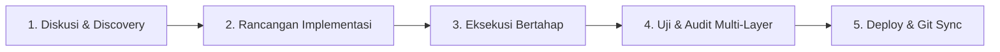

# RMI PCNU Demak Web — Engineering Standards & Development SOP

Dokumen ini merupakan panduan resmi arsitektur sistem, konvensi penulisan kode, serta protokol kerja pengembangan aplikasi web **PC RMI NU Kabupaten Demak (Kota Wali)**. Seluruh agen AI dan pengembang wajib mematuhi standar ini guna menjaga stabilitas, keamanan, performa, dan konsistensi data.

---

## 1. Filosofi & Prinsip Inti Rekayasa (*Core Tenets*)

1. **Passwordless First (Ramah Pesantren)**:
   - Menghilangkan kata sandi statis yang rentan terlupa di kalangan masyayikh dan operator pondok.
   - Menggunakan mekanisme autentikasi ganda: **1-Klik Akun Resmi Pengurus (Fast Login)** dan **Email OTP 6-Digit** (berlaku 5 menit) via MailApp/GmailApp berformat template HTML resmi.
2. **Zero-Cost High-Reliability Infrastructure**:
   - Menggunakan Google Sheets sebagai *Headless Relational Database* dan Google Drive sebagai *Cloud CDN Asset Storage*.
   - Tidak membebani organisasi dengan biaya sewa server/database bulanan, namun memiliki ketersediaan tinggi setara infrastruktur Google Cloud.
3. **Lightweight & Dependency-Free (Vanilla SPA + Tailwind)**:
   - Menggunakan HTML5, Vanilla JavaScript modern, dan Tailwind CSS tanpa runtime framework berat (React, Vue, Angular).
   - Waktu muat kilat, konsumsi data minimal di jaringan seluler daerah, dan kompatibel penuh pada seluruh browser ponsel maupun desktop.
4. **Strict Data Integrity & Concurrency Guard**:
   - Seluruh transaksi penulisan (registrasi mandiri, penerbitan ID resmi, perubahan status verifikasi) wajib dilindungi antrean atomik **`LockService.getScriptLock()`** untuk mencegah benturan data ganda (*race conditions*).

---

## 2. Protokol Kerja 5-Tahap (*5-Stage Engineering Workflow Lifecycle*)

Setiap penambahan fitur baru, perbaikan masalah (*bug fix*), atau perubahan arsitektur **WAJIB** mengikuti siklus 5 tahap secara berurutan:

### Tahap 1: Diskusi & Penyelarasan Konsep (*Discussion & Discovery*)
- **Aturan Emas**: *DILARANG KERAS mengubah atau menyentuh kode sebelum tercapai kesepahaman penuh dengan pengguna.*
- Teliti masalah hingga ke akar atau bedah kebutuhan fitur secara mendalam.
- Periksa tangkapan layar, log error, dan data spreadsheet terkait.
- Jelaskan temuan dan opsi arsitektur secara transparan kepada pengguna.

### Tahap 2: Pembuatan Rancangan Implementasi (*Implementation Blueprint*)
- **Aturan Emas**: *Rancangan harus terstruktur per fase dan disetujui secara eksplisit oleh pengguna.*
- Dokumen rancangan wajib mencakup:
  1. Ringkasan tujuan fitur/perbaikan.
  2. Diagram alur atau arsitektur komponen.
  3. Daftar berkas yang disentuh (Frontend, Backend `.gs`, Database Sheets, Stylesheet).
  4. Pembagian fase kerja (Fase 1, 2, 3...) yang terukur dan mandiri.
  5. **Titik Henti Wajib (*Checkpoint*)**: Minta persetujuan pengguna sebelum melangkah ke tahap eksekusi.

### Tahap 3: Eksekusi Bertahap (*Disciplined Modular Execution*)
- **Aturan Emas**: *Eksekusi bertahap, modular, dan menjamin zero-regression (tidak merusak fitur yang sudah berjalan).*
- Terapkan pemecahan modul backend Google Apps Script 00–07.
- Gunakan skrip sementara di folder `scratch/` untuk menangani manipulasi file atau eksekusi transformasi kode yang kompleks guna menghindari galat *character escaping* di shell PowerShell.
- Pastikan kontras warna antarmuka terkunci kuat (*color invariance*) dan layout responsif.

### Tahap 4: Pengujian & Audit Menyeluruh (*Rigorous Multi-Layer Verification*)
- **Aturan Emas**: *Tidak ada klaim "selesai" tanpa bukti pengujian objektif.*
- **4 Lapisan Verifikasi Wajib**:
  1. **Uji Sintaks Lokal**: Validasi parser JavaScript (`new Function(...)`) dan pastikan CSS Linter bersih (**0 errors, 0 warnings**).
  2. **Uji Live API Cloud**: Eksekusi pengujian HTTP langsung ke endpoint Apps Script (Healthcheck GET, GET Master, POST Auth, normalisasi payload, dan proteksi duplikasi).
  3. **Uji Integritas Database & Drive**: Pastikan baris data tersimpan di sheet yang benar, status akun sesuai, antrean verifikasi tercatat, dan upload file Drive menghasilkan link CDN publik `lh3.googleusercontent.com`.
  4. **Uji Visual UI & Cetak**: Pastikan kontras teks tajam (WCAG AA), tidak ada teks putih di atas putih, logo cetak valid, dan layout cetak/PDF efisien (1–3 lembar A4).

### Tahap 5: Deployment & Sinkronisasi Git (*Deploy & Git Versioning*)
- **Aturan Emas**: *Semua perubahan yang telah lolos uji wajib dicatat dalam riwayat versi resmi.*
- Kompilasi ulang aset stylesheet: `npx tailwindcss -i assets/css/input.css -o assets/css/styles.min.css --minify`.
- Unggah backend ke Google Apps Script: `clasp push -f` lalu rilis versi baru `clasp deploy -i <DEPLOYMENT_ID> -d "<deskripsi versi>"`.
- Commit git dengan format *Conventional Commits*: `feat(...)`, `fix(...)`, `refactor(...)`.
- Push ke repositori resmi GitHub: `https://github.com/nazirulss/rminudemak.git` (branch `main`).

---

## 3. Arsitektur Backend Modular: Google Apps Script (00–07)

Backend Google Apps Script tidak boleh ditulis dalam satu berkas monolitik panjang, melainkan dipecah menjadi 8 modul berurutan nomor:

| Berkas Backend | Peran & Tanggung Jawab Utama |
| :--- | :--- |
| **`00_Config_Security.gs`** | Objek konfigurasi global (`CONFIG`), kamus 12 skema tabel (`SCHEMAS`), dan helper `createJsonResponse()`. |
| **`01_Router.gs`** | Router tunggal `doGet(e)` dan `doPost(e)` yang dilindungi `LockService.getScriptLock()`. |
| **`02_Auth_RBAC.gs`** | Fast Login, verifikasi Email OTP 6-digit (Cache 5 menit), manajemen akun pengguna, dan matriks hak akses RBAC. |
| **`03_Pesantren_Core.gs`** | Logika bisnis inti lembaga, penerbitan Kode Resmi berurutan tanpa benturan (`issueNextPesantrenCode`), registrasi mandiri, dan integrasi pangkalan data. |
| **`04_Verifikasi_Audit.gs`** | Manajemen status peninjauan (*under_review*, *verified*, *rejected*) dan pencatatan riwayat audit transaksi (*audit trail*). |
| **`05_CMS.gs`** | Pengelolaan konten website publik dinamis (beranda, profil, layanan, berita & warta). |
| **`06_MasterData.gs`** | Master data 14 kecamatan se-Demak, tipologi pesantren, dan penjaminan header tabel otomatis (*self-healing headers*). |
| **`07_Drive_Uploader.gs`** | Penanganan berkas Base64 ke Google Drive dengan *resilient fallback folder* dan penerbitan link CDN langsung `https://lh3.googleusercontent.com/d/{id}`. |

---

## 4. Standar Database Spreadsheet (`RMINU_DEMAK_DB`)

- **Spreadsheet ID**: `1wd8wy229F4OVywQZvnSPSv9Ckyo1qlIusjJ4joKN0sE`
- Mengadopsi **Database Dictionary v1.1** dan standar **Digdaya Pesantren PBNU**.
- Terdiri atas 12 tab relasional:
  1. `pesantren`: Master data lembaga pesantren.
  2. `pesantren_locations`: Geospasial koordinat, alamat, dan 14 kecamatan.
  3. `pesantren_leaders`: Khadimul Ma'had / Dewan Asatidz / Pengasuh.
  4. `pesantren_contacts`: Kontak resmi, WhatsApp, medsos.
  5. `pesantren_education`: Kurikulum kitab kuning (turots) marhalah ula/wustha/ulya.
  6. `pesantren_santri_aggregates`: Data statistik santri mukim & non-mukim.
  7. `pesantren_development_profiles`: Profil kemandirian ekonomi & Kopontren.
  8. `app_users`: Akun terdaftar pengelola portal.
  9. `app_roles`: Definisi 7 tingkatan peran resmi.
  10. `rbac_permissions`: Matriks wewenang per modul.
  11. `verification_reviews`: Antrean review verifikasi lembaga baru.
  12. `audit_logs`: Log jejak audit seluruh transaksi sistem.

---

## 5. Matriks Hak Akses 7 Peran (RBAC) & Route Guard

### Ke-7 Peran Resmi:
1. **Super Admin (PCNU Demak & IT Core)**: Otoritas penuh (Level 1) ke seluruh 11 modul dan konfigurasi.
2. **Admin Kabupaten (Pengurus Harian PC RMI NU)**: Otoritas cabang (Level 2) untuk approval verifikasi, direktori, dan rekapitulasi kabupaten.
3. **Admin Kecamatan (Koordinator 14 MWC NU)**: Otoritas wilayah (Level 3), data terisolasi otomatis khusus kecamatannya.
4. **Operator Pesantren (Sekretariat Pondok)**: Entri data (Level 4) Buku Induk 9 Domain pondoknya sendiri.
5. **Dewan Masyayikh / Pengasuh**: Akses eksekutif (Level 5) untuk supervisi kurikulum turots dan status pondok (*read-focused*).
6. **Tim Asesor & Verifikator**: Validasi lapangan (Level 6) untuk penilaian borang fisik dan rekomendasi akreditasi.
7. **Tamu Terdaftar / Peneliti**: Akses terbatas (Level 7) untuk riset direktori dan data agregat publik.

### Proteksi Ganda (Dual-Layer Guard):
- **Frontend Guard**: Fungsi `navigateTo()` di `admin.html` memeriksa `RBAC_MODULE_PERMISSIONS[roleKey][moduleName]`. Jika `none`, akses ditolak dan dialihkan ke fallback resmi.
- **Backend Guard**: Akun non-aktif (`is_active: false`) diblokir dari proses login hingga diverifikasi admin cabang.

---

## 6. Standar Pendaftaran Mandiri (*Self-Registration*)

- Menggunakan **Multi-Step Wizard 4 Tahap**:
  - Langkah 1: Identitas Operator / Pemohon (Nama, Email, WhatsApp, Jabatan).
  - Langkah 2: Profil Lembaga (Nama Resmi, Nama Populer, NSPP, Tahun, Kategori, Pengasuh Utama).
  - Langkah 3: Domisili, Legalitas, Berkas Rekomendasi MWC, dan *Pakta Integritas Pesantren Ramah Anak*.
  - Langkah 4: Tanda Terima Registrasi (`REG-DMK-XXXXXX`).
- Akun operator baru disimpan dengan status **`is_active: false`** dan visibilitas pesantren **`private`**.
- Sistem otomatis mengirimkan bukti tanda terima berformat email HTML resmi via MailApp.

---

## 7. Standar Desain Cetak Dokumen Fisik & Simpan PDF

- **Kunci Warna Cetak**: Wajib menyertakan `-webkit-print-color-adjust: exact !important; print-color-adjust: exact !important;` agar badge dan border tidak pudar.
- **Kop Surat Standar Dokumen PCNU**:
  - Logo resmi: `assets/img/logo_rmi.png` (resolusi tajam, bukan file webp yang tidak ada).
  - Teks Kop resmi: PENGURUS CABANG RABITHAH MA'AHID ISLAMIYAH NAHDLATUL ULAMA — PC RMI NU KABUPATEN DEMAK (KOTA WALI).
  - Garis ganda resmi (tebal 2.5px dan tipis 0.8px).
  - Tanggal cetak dinamis WIB.
- **Penghematan Lembar A4**:
  - Kartu peran disembunyikan jika sedang di-filter (`.card-panduan.hidden { display: none !important; }`).
  - Blok informasi dalam kartu peran ditata dalam **grid kompak 2x2** dengan font 8pt–10.5pt.
  - Wajib menyertakan `page-break-inside: avoid; break-inside: avoid;` untuk mencegah kartu atau tabel terpotong canggung di batas halaman.

---

## 8. Deployment & Identitas Repositori

- **Repositori GitHub**: `https://github.com/nazirulss/rminudemak.git` (Branch: `main`)
- **Apps Script Deployment ID**: `AKfycbw-0Y0IM-uR326H4bkWAvbQ179Q5NrfgJT8ihOf8lY7C_joVwrT136fPRjRqu8U9jhU`
- **Web App Live URL**: `https://script.google.com/macros/s/AKfycbw-0Y0IM-uR326H4bkWAvbQ179Q5NrfgJT8ihOf8lY7C_joVwrT136fPRjRqu8U9jhU/exec`
- **Domain Publik**: `https://rminudemak.org`

---
*Dokumen ini dirumuskan bersama pada 15 November 2026 sebagai panduan baku pengembangan platform PC RMI NU Kabupaten Demak.*
